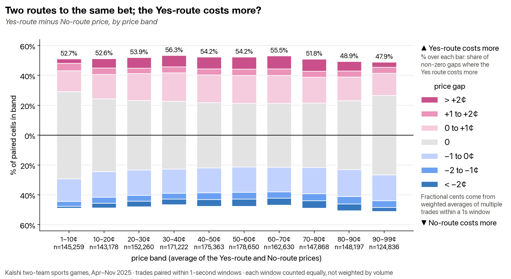
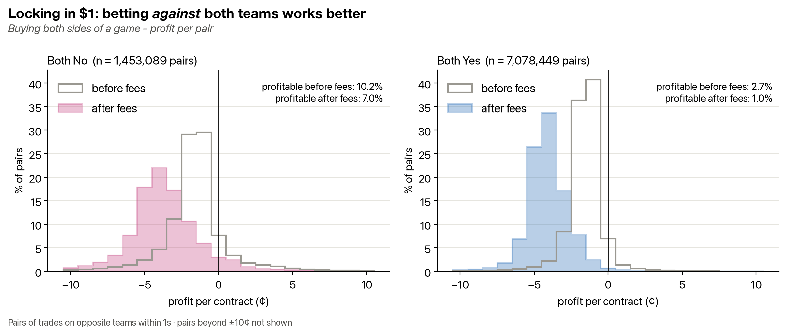
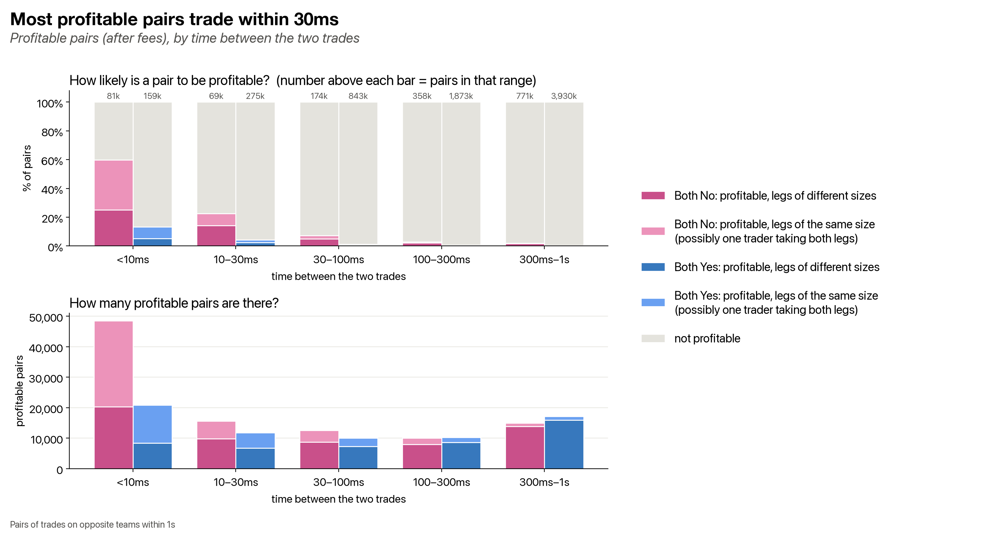

# Kalshi linked-books analysis

In a two-team sports game on Kalshi, each team's win market has its own order book. "Yes on Team A" and "No on Team B" pay out in exactly the same cases, so they should cost the same. And since exactly one team wins, buying No on both teams should never cost less than the guaranteed $1 payout.

This project uses actual trades to measure how often those relationships break.

## Findings

**In short:** buying "No" on both teams of a Kalshi sports game was sometimes profitable after fees, but the opportunity was small, and most of it was taken within milliseconds, apparently by automated traders.

- **Prices mostly agree.** The Yes and No routes to the same bet cost exactly the same in roughly 40–60% of one-second windows, and most other gaps are within 1¢. When they differ below 80¢, the Yes route is the dearer one 52–56% of the time.
- **Buying No on both teams.** Of 1,453,089 pairs of trades made within a second of each other, 10.2% cost less than \$1 before fees and 7.0% were still profitable after Kalshi's taker fees. Buying Yes on both teams worked far less often: 1.0% after fees.
- **It was fast.** About 70% of the profitable pairs had both trades within 100 ms of each other, consistent with an automated trader taking both legs. This is an inference from timing, since trader identity isn't in the data.
- **It was small.** If every profitable pair had been captured, each contract used once, profit after fees would be about \$450,000 over seven months. About \$227k of that came from same-size pairs under 300 ms apart, and only about \$28k from pairs more than 300 ms apart. This is an estimate from past trades, not what anyone earned.

## Data and method

- **Source:** [Jon Becker's prediction-market dataset](https://github.com/jon-becker/prediction-market-analysis), Kalshi markets and trades.
- **Sample:** game-winner markets from 10 Kalshi series (MLB, ATP, WTA, NCAA football, NCAA men's and women's basketball, NHL, NBA, WNBA and NFL) with trades from 14 April to 23 November 2025. Only games with exactly two markets, one per team, are included, so sports with a separate draw market are left out. 300 games without a clean result were removed: 292 never resolved and 8 resolved No on both sides. That leaves 7,447 games, 14,894 markets and 32.4M trades.
- **Route comparison (chart 1):** trades are grouped into one-second windows for each game and team. Within a window, each route's price is the volume-weighted average of its trades, and windows with trades on both routes are compared.
- **Pairs (charts 2 and 3):** each trade is paired with the most recent trade on the opposite team's market, on the same side (both Yes or both No), within one second.
- **Fees:** Kalshi's taker formula, 0.07 × P × (1 − P) per contract with P in dollars, applied to both legs.
- **Dollar estimate:** profitable pairs are processed in time order, and each trade's contracts can only be used once.
- Built with Python 3.14, pandas, NumPy, matplotlib and DuckDB. I wrote the analysis queries and pandas code myself, with Claude as a tutor; Claude wrote the plotting functions and the data-build script.

## Reproducing it

1. Download the dataset by following the instructions in Becker's repository.
2. Build the cleaned files: `python build-two-team-data.py path/to/becker-dataset/data/kalshi`, pointing it at the `data/kalshi` folder inside the dataset you downloaded. This reads the raw files from there and writes `two_team_markets_clean.parquet`, `two_team_trades_clean.parquet` and `unclean_events.csv` into `data/`. It reads all of Kalshi's trades, so it takes a few minutes.
3. Install the libraries (tested on Python 3.14): `pip install -r requirements.txt`.
4. Run `python yes-no-gap.py` to make `chart-1.png`, and `python cross-book-profit.py` to make `chart-2.png` and `chart-3.png`. The first run of `cross-book-profit.py` takes a couple of minutes and saves its tables in `cross_book_1s.duckdb`, so later runs are quick. Delete that file after changing either of its `CREATE TABLE` queries.

## Limitations

- Only completed trades are available, not order-book snapshots, so this can't show what was actually on offer at a given moment, or what a slower trader could have bought.
- Most pairs are two different traders' trades. A pair's profit is what someone would have made by buying both legs at those prices, not money anyone is known to have made.
- Trader identity isn't in the data, so the automated-trader reading is a hypothesis based on timing and equal leg sizes.
- Only the taker fee is modelled, since acting on a gap quickly means paying the price on offer. Kalshi rounds each order's fee up to the next cent, which isn't modelled, so profits on small orders are slightly overstated.
- Averaging trades within a one-second window produces fractional-cent gaps in chart 1.
- When trades share an exact timestamp, the pairing can vary slightly between runs, which moves the totals by a small amount.
- This is analysis only. No trades were placed.
